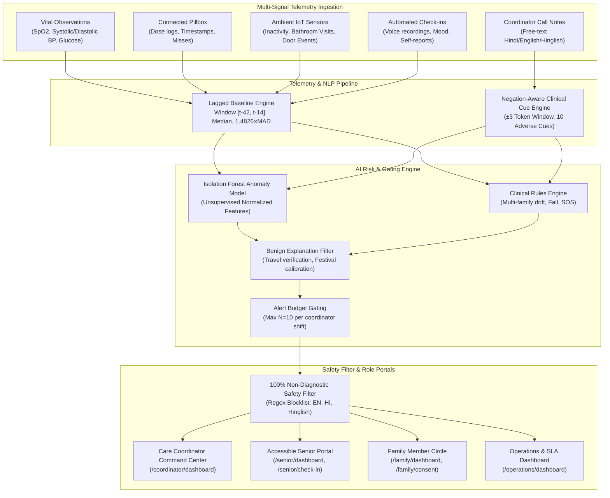
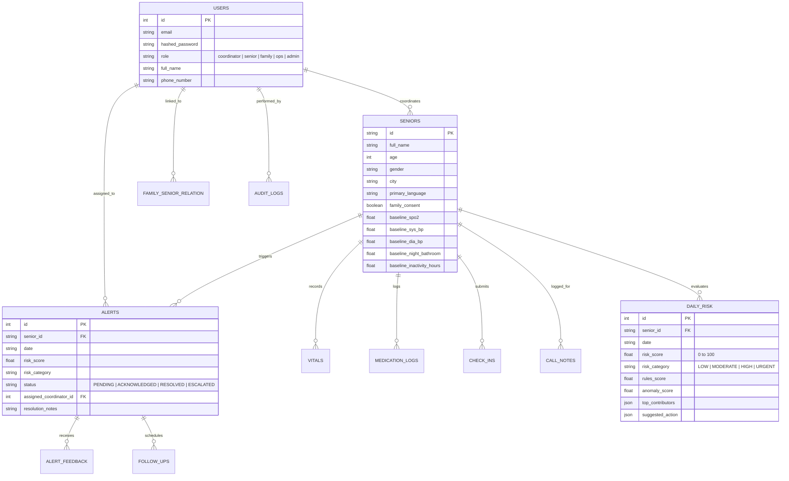

# SaathiCare AI — System Architecture & Data Flow

**Tagline:** Every Signal Matters. Every Senior Matters.  
**Core Mission:** AI-Powered Early Warning Decision Support for Seniors Living at Home.

---

## 1. High-Level System Architecture

SaathiCare AI is a full-stack, human-in-the-loop healthcare decision-support system. It answers three core operational questions every morning:
1. **WHO needs attention today?** (Triage priority queue strictly capped at $N=10$ seniors/coordinator)
2. **WHY is this senior's risk increasing?** (SHAP and personal baseline deviation narratives in English, Hindi, and Hinglish)
3. **WHAT should the Care Coordinator do next?** (Protocolized 3-question telephone scripts and action routing)

---

## 2. Telemetry Ingestion Contracts

All signals arrive through standardized REST endpoints at `/api/v1/signals/{senior_id}`:

| Signal Family | Schema / Model | Key Fields | Source Hardware / Input |
| :--- | :--- | :--- | :--- |
| **Vital Signs** | `VitalObservation` | `spo2`, `sys_bp`, `dia_bp`, `blood_glucose` | Bluetooth Pulse Oximeter, Smart BP Cuff |
| **Medication Logs** | `MedicationLog` | `status` (taken/missed), `taken_pct`, `schedule_id` | Connected Smart Pill Dispenser |
| **Ambient IoT Activity** | `VitalObservation` | `inactivity_hours`, `night_bathroom_visits`, `door_events` | Fall radar, Sleep sensor mat, PIR door sensor |
| **Daily Voice Check-in** | `CheckIn` | `wellbeing_status`, `voice_note_url`, `fatigue_reported` | Senior Web Portal, Automated IVR phone check-in |
| **Coordinator Notes** | `CallNote` | `raw_text`, `call_duration_seconds`, `contact_type` | Care Coordinator CRM entry (Hindi/English) |

---

## 3. Database Entity Relationship (ER) Model

The relational persistence layer is implemented in SQLite/PostgreSQL with SQLAlchemy 2.0:

---

## 4. Role-Based Access Control (RBAC) & Boundary Enforcements

Data access permissions are enforced directly in the database query layer:

1. **Care Coordinator (`coordinator`)**:
   - Access restricted to seniors where `senior.assigned_coordinator_id == current_user.id`.
   - Accessing another coordinator's senior immediately raises `HTTP 403 Forbidden`.
2. **Family Member (`family`)**:
   - Access restricted to the explicitly linked senior in `family_senior_relation`.
   - Reassuring, non-alarming aggregated weekly wellbeing summaries.
   - Acute notifications dispatched **only** when `family_consent == True`.
3. **Operations Manager (`ops`)**:
   - Macro-level operational views: alert velocity, response time SLA distributions, coordinator workloads.
   - **Confidential Notes Redacted**: Personal call notes and raw audio are excluded.
4. **Senior Citizen (`senior`)**:
   - High-contrast, large touch targets, English/Hindi toggles, routine check-offs, voice check-in, and emergency SOS button.

---

## 5. Non-Diagnostic Safety Charter

SaathiCare AI does not provide clinical diagnoses. Every outgoing string generated for coordinators or families passes through `backend/app/services/safety.py`:
- Blocklist scrubs medical disease terms across English, Hindi, and Hinglish (`pneumonia`, `heart attack`, `stroke`, `diabetes`, `copd`, `dementia`, etc.).
- Replaces clinical diagnostic assumptions with neutral behavioral and biomarker trajectory descriptions (`respiratory variation`, `adherence gap`, `nighttime restlessness`).
- Clearly emphasizes that doctor appointments are human coordinator recommendations, not system prescriptions.

